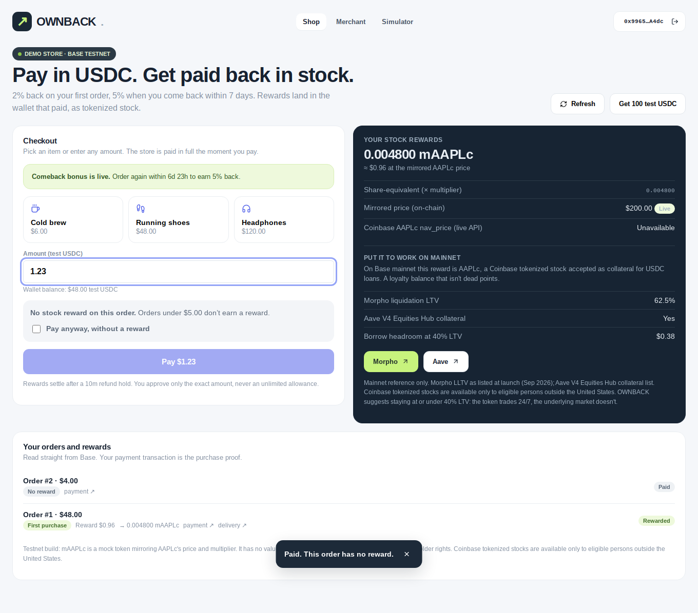

# OWNBACK

**Pay in USDC. Get paid back in stock.**

OWNBACK is a checkout on Base that pays customers back in tokenized stock instead of points: a reward on the first
order, a bigger one when they come back, and a balance that works as collateral on mainnet.

Built for Base **Stocks Maxxing Season**, track **Programmable Stock Markets**. Version 3.2.



Screenshots are from the automated browser test on a local chain: [quote](docs/screenshots/shop-quote.png) ·
[mobile](docs/screenshots/shop-mobile.png) · [merchant console](docs/screenshots/merchant.png).

## Why the stock is the product

Points are dead balances. A Coinbase tokenized stock on Base is a live asset: Morpho and Aave V4 accept them as
collateral for USDC. OWNBACK turns everyday spending into a position that can be held or put to work. Swap the stock
for points and the product stops working — that's the test we built against.

## How it works

1. **The merchant funds a campaign** in USDC: first-order rate, comeback rate, per-order cap, minimum order, refund
   hold, return window.
2. **The customer pays** through the `Ownback` contract. The merchant receives the full payment in the same
   transaction and the reward is **reserved** from the budget, so it can't be withdrawn later.
3. **After the refund hold**, the reward settles as tokenized stock into **the wallet that paid**, by the customer
   or the keeper.
4. **A comeback order** inside the window earns the higher rate. One comeback per customer per campaign.

The payment is the purchase proof: no order feed, no webhook to trust, no claim link. The keeper can't invent
orders or redirect rewards.

### Guarantees the contract enforces

- **No silent downgrade.** The checkout carries the reward the customer was shown. If it's no longer available
  (budget used, campaign paused, window closed), the payment reverts before any USDC moves. A customer can choose to
  pay with no reward, but only by explicitly opting in.
- **No double charge.** Each checkout has a client-generated reference, unique per payer. A retried submission
  reverts instead of charging twice, and nobody else can burn a customer's reference.
- **Promised rewards stay payable.** Reserved rewards can't be withdrawn, and a merchant pause doesn't cancel them.
- **Fails closed on bad prices.** Settlement refuses a price older than its source allows; the keeper can't re-stamp
  an old quote as fresh.

See [SECURITY.md](SECURITY.md) for the full threat model.

## Scope and limits

A standalone, crypto-native demo store on **Base Sepolia**, not a Shopify integration or multi-merchant SaaS.
Merchants fulfil goods off-chain. The adapter **mints a zero-value mock stock** whose price mirrors Coinbase's
`nav_price`; that is not a market buy. Lending links are references, not an integrated credit flow. A real launch
needs an approved securities provider, eligibility checks (Coinbase tokenized stocks are for eligible persons
outside the US), a compliant execution route, issuer-policy tests and an independent audit.

## Quick start (local chain)

Needs Node 22+, git and Foundry.

```bash
npm ci
./contracts/install-deps.sh
anvil --silent                              # terminal A
```

```bash
cd contracts                                # terminal B
DEPLOYER_PRIVATE_KEY=0xac0974bec39a17e36ba4a6b4d238ff944bacb478cbed5efcae784d7bf4f2ff80 \
KEEPER_ADDRESS=0x70997970C51812dc3A010C7d01b50e0d17dc79C8 \
forge script script/DeployTestnet.s.sol:DeployTestnet --rpc-url http://127.0.0.1:8545 --broadcast
cd ..
npm run e2e:local                           # full lifecycle with the real keeper
npm run write:local-env && npm run dev      # then open http://localhost:3000/shop
```

These are anvil's public dev keys; never use them anywhere else. Base Sepolia: see [DEPLOY.md](DEPLOY.md).

## Tests

| Command                                             | Covers                                                                                                                |
| --------------------------------------------------- | --------------------------------------------------------------------------------------------------------------------- |
| `npm run test:contracts`                            | 43 Foundry tests incl. 512-run fuzz of reward bounds and budget conservation                                          |
| `npm test`                                          | 34 tests: reward engine, price parser, amount parsing, price status, checkout-intent state machine, release integrity |
| `npm run e2e:local`                                 | 15 lifecycle checks on a real local chain with the real keeper                                                        |
| `npm run test:ui`                                   | Real browser + injected EIP-6963 wallet: connect, faucet, quote, pay, settle, opt-in, merchant view                   |
| `npm run lint` · `check` · `format:check` · `build` | ESLint, TypeScript, Prettier, production build                                                                        |
| `npm run release:preflight`                         | Checkout, ABI and price-source coherence                                                                              |
| `npm run prices:check`                              | Parser against the live Coinbase API (needs network)                                                                  |

CI runs all of them except `prices:check` on every push. Results for this release: [BUILD_AUDIT.md](BUILD_AUDIT.md).

## Structure

```
contracts/src/Ownback.sol          checkout, reservations, refunds, settlement (Ownable2Step, ReentrancyGuard)
contracts/src/mocks/               testnet USDC, 8-decimal B20-style stock, price-mirror adapter
contracts/test/Ownback.t.sol       unit, negative, security and fuzz tests
src/app/                           shop, merchant, simulator, error and 404 pages, API routes
src/components/                    wallet picker, shop and merchant panels, UI primitives
src/hooks/                         wallet and toast contexts, data, checkout, chain clock, polling
src/lib/                           pure logic (amount, price status, checkout intent), reads, wallet, config
scripts/keeper.ts                  stateless keeper: price mirror + settlement
scripts/e2e-local.mjs              chain lifecycle test
tests/ui/wallet-journey.mjs        real-browser journey
```
