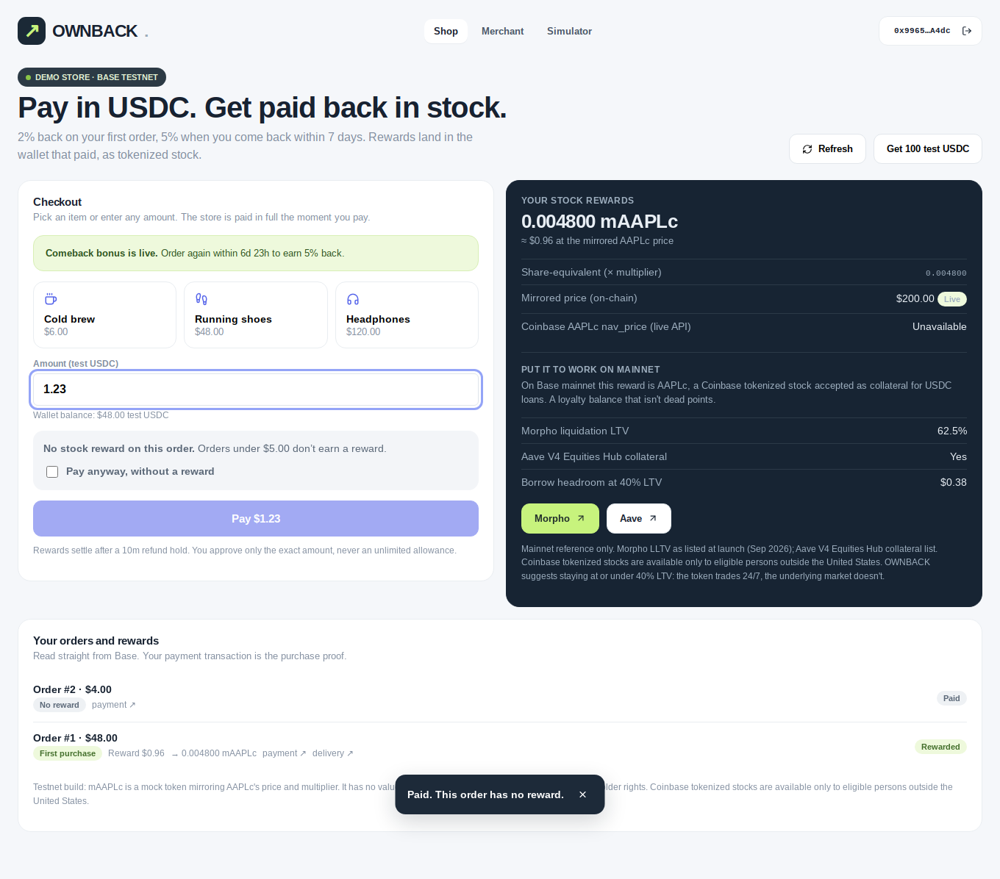

# OWNBACK v3.10.2 — Base Stocks Maxxing judge candidate

**Track:** Agentic Stock Finance · **Demonstration environment:** Base Sepolia / offline mock · **Base mainnet:** **NOT DEPLOYED**.

OWNBACK is a merchant-funded stock-linked rewards protocol. One immutable stock token can be settled by a configured vault. A policy engine only proposes feasible constraints and refuses impossible stock requests. A preference signature **cannot trade, invest, transfer, or claim**. All retention is **observed, not causal lift**.

## Begin here

- [`HISTORY.md`](HISTORY.md#v310-release) — v3.10 changes, installation, testing and limitations, plus the v3.10.1 evidence gate and v3.10.2 proof execution notes.
- [`HISTORY.md`](HISTORY.md#hackathon-submission) — the canonical 90-second judge script and Base submission claims.
- [`evidence/proofs.json`](evidence/proofs.json) — mandatory proof register; status is tracked in [Proof status](#proof-status) below.

## Primary navigation

`/` → `/judge` → native Base campaign / purchases on `/growth` → one-click allowed/refused `/allocation` → `/growth` observed outcomes.

- **Merchant proof:** `/growth` reads native campaign USDC balances and purchased/delivered receipts only when a configured contract is accessible. Authenticated Shopify cohorts are _secondary_.
- **Agent policy:** `/allocation` has two 20-second, clearly labeled offline fixtures and a separate backend policy route. Backend policy refuses if the settlement token is unconfigured.
- **Proof register:** `/judge#proofs` never manufactures URLs, balance claims or signatures. A tagged release fails strict CI until evidence is attached.

## Fresh install on a machine with npm network access

```bash
node --version # Node 22.16.0 recommended
npm ci
npm run check
npm run test:allocation
npm run test:retention
npm run test:judge
npm run build
npm run verify:manifest
npm run verify:proofs
```

## Live deployment (Base Sepolia, chain 84532)

- **App:** https://ownback-project.onrender.com — customer store at `/shop`, judge page at `/judge`.
- Assets are **mock/testnet** (mock USDC, mAAPLc). Base mainnet is **NOT DEPLOYED**.

| Contract             | Address                                                                                                                         |
| -------------------- | ------------------------------------------------------------------------------------------------------------------------------- |
| OWNBACK              | [`0xB65c65E2FC79dc8146fd22fe379F8B58D8476b13`](https://sepolia.basescan.org/address/0xB65c65E2FC79dc8146fd22fe379F8B58D8476b13) |
| Mock USDC            | [`0x421e74034DA94a9e4f044F7134B523ffBD75DdE9`](https://sepolia.basescan.org/address/0x421e74034DA94a9e4f044F7134B523ffBD75DdE9) |
| Mock stock (mAAPLc)  | [`0xc0d725AF34a183d484bAe06A771D62d8e2e1BB6a`](https://sepolia.basescan.org/address/0xc0d725AF34a183d484bAe06A771D62d8e2e1BB6a) |
| Settlement adapter   | [`0x36d0c193AA2bCAD589dBf0490853d2c2b1092b13`](https://sepolia.basescan.org/address/0x36d0c193AA2bCAD589dBf0490853d2c2b1092b13) |
| Shopify reward vault | [`0xce9FD4eDE042324f3C1F72783d87922bFE485039`](https://sepolia.basescan.org/address/0xce9FD4eDE042324f3C1F72783d87922bFE485039) |
| Keeper / merchant    | [`0xc2a5d5C6cb6dF500BBa4214DD5CDA40f66970379`](https://sepolia.basescan.org/address/0xc2a5d5C6cb6dF500BBa4214DD5CDA40f66970379) |

Campaign **1**: funded with 5,000 mock USDC, 2% first-purchase and 5% comeback reward, $5 minimum order, 10-minute refund hold. Full addresses and deploy block: [`contracts/deployments/84532.json`](contracts/deployments/84532.json).

## Proof status

Each proof is a real Base Sepolia transaction. Its receipt is saved under [`evidence/receipts/`](evidence/receipts/) and registered in [`evidence/proofs.json`](evidence/proofs.json). Anyone can re-check them against the chain with `npm run verify:proofs`.

| #   | Proof                                                                                                      | Status      | Evidence                                                                                                               |
| --- | ---------------------------------------------------------------------------------------------------------- | ----------- | ---------------------------------------------------------------------------------------------------------------------- |
| 1   | Merchant funds campaign 1 (`CampaignFunded`)                                                               | ✅ Verified | [tx `0x81398f18…`](https://sepolia.basescan.org/tx/0x81398f181e9ce5c892c2c2cdbb83346175132acd2151c57d2ed07e6b8f755503) |
| 2   | Customer pays order, purchase #1, 48 USDC, 0.96 USDC reward reserved (`Purchased`, orderRef `0x9115ad7a…`) | ✅ Verified | [tx `0x67a480a2…`](https://sepolia.basescan.org/tx/0x67a480a270a2fea55531882d1d586c88c413948a02cf370ea124f7d813d3928e) |
| 3   | Reward settled after the refund hold, 0.0096 mAAPLc delivered to the customer (`RewardDelivered`)          | ✅ Verified | [tx `0x9186e9f0…`](https://sepolia.basescan.org/tx/0x9186e9f0b2d5c7d5c1178d60074288306f41396c5d635d6b8dbe205204b1f0a6) |
| 4   | Wallet preference signature accepted (HTTP 200), replay rejected (HTTP 409)                                | ⏳ Pending  | —                                                                                                                      |

Proofs 1–3 pass `npm run verify:proofs:strict` and belong to the same campaign (1), purchase (#1) and customer. Proofs 2 and 3 were sent from a MetaMask smart account, so the transactions are routed through a relay. The verifier accepts them because the events are emitted by the OWNBACK contract address itself, and no other contract can emit an event from that address.

## Remaining before submission

- [x] Proof 3: purchase #1 settled from **My orders** on `/shop`.
- [ ] Proof 4: set `OWNBACK_PILOT_SETTLEMENT_STOCK` and `OWNBACK_PREFERENCE_RECEIPTS_ENABLED=true` on the host, then run `scripts/create-signed-preference.mjs` and `scripts/capture-preference-replay.mjs`.
- [ ] Add the `BASE_SEPOLIA_RPC_URL` GitHub secret, run `npm run verify:proofs:strict`, tag `v3.10.3` and confirm `.github/workflows/submission-gate.yml` passes on that tag.

## Remaining before production (Base mainnet)

- No funded mainnet inventory, real customer stock balance, legal/issuer approval or independently audited mainnet settlement exists yet.
- Mainnet deploy with real USDC and a real (non-mock) stock settlement provider.
- Paid RPC provider, scheduled keeper and monitoring.
- Install on the production Shopify store and configure the compliance webhooks (`/api/shopify/compliance`).
- Base mini app for the customer side (`/shop`) only; merchant pages stay on the website.

For local Anvil evidence, label it **ANVIL ONLY** and attach real transaction/log files. No public explorer URL exists for a local-only Anvil chain.

---

_Everything below describes earlier builds and is kept for reference._

# OWNBACK v3.6 — Hybrid commerce with Shopify UCP Shopping Concierge

**New:** `/agentic` combines conversational **merchant-grounded product discovery**, Shopify UCP catalog/variant lookup and cart creation, and a safe _buyer-controlled merchant checkout handoff_. Shopify app OAuth, signed order/refund webhooks, customer claim and a separate Base Sepolia reward vault remain in place. OWNBACK's native USDC commerce and Bankr read-only research are unchanged.

Start with [`DEPLOY.md`](DEPLOY.md), then follow the existing hybrid and commerce docs. Preview mode works without merchant credentials but uses sample products and **does not process payments or issue rewards**.

**Current release blocker:** the inherited v3.5 `package-lock.json` is missing the `pg` / `@types/pg` lock entries; regenerate it with `npm install --package-lock-only` on a network-connected machine, commit it and run `npm ci`, TypeScript, Next build and real Shopify staging tests. This ZIP is **source-complete for UCP discovery/cart pilot integration, not a certified live deployment**.

---

# OWNBACK 3.5 — Hybrid commerce pilot (Shopify + Base)

**New:** [Full hybrid developer setup](DEPLOY.md) · [Release notes / verification](HISTORY.md) · [Interactive static design preview](docs/preview/OWNBACK_Hybrid_Interactive_Preview.html)

The pilot supports two buyer experiences: existing **native Base USDC checkout** and an optional, authenticated **Shopify paid-order integration**. Shopify's normal checkout continues to process Web2 payments; OWNBACK funds **synthetic stock rewards** separately from the merchant's Base Sepolia USDC vault. No second charge to Shopify buyers, no real equities, no live Bankr loans. The v3.4 features remain available.

**Important:** source handoff, not a production deployment. See explicit release gates and the inherited npm lockfile caveat before claiming build readiness.

---

> **v3.4 integrated pilot:** Start with [RELEASE_V3_4.md](HISTORY.md) and [WINNING_PROTOCOL.md](HISTORY.md). The original README below describes the inherited v3.3 app, including older Bankr borrowing flows. Those are disabled and superseded by the v3.4 docs.

# OWNBACK

**Pay in USDC. Get paid back in stock.**

OWNBACK is a checkout on Base that pays customers back in tokenized stock instead of points: a reward on the first
order, a bigger one when they come back, and a balance that works as collateral on mainnet.

Built for Base **Stocks Maxxing Season**. Programmable Stock Markets, with an Agentic Stock Finance hook via Bankr. Version 3.3.



Screenshots are from the automated browser test on a local chain: [quote](docs/screenshots/shop-quote.png) ·
[mobile](docs/screenshots/shop-mobile.png) · [merchant console](docs/screenshots/merchant.png).

**Agent-native.** Settle a reward or borrow against it in your own wallet, or ask a Bankr agent to do it — see [BANKR.md](DEPLOY.md).

## Why the stock is the product

Points are dead balances. A Coinbase tokenized stock on Base is a live asset: Morpho and Aave V4 accept them as
collateral for USDC. OWNBACK turns everyday spending into a position that can be held or put to work. Swap the stock
for points and the product stops working — that's the test we built against.

## How it works

1. **The merchant funds a campaign** in USDC: first-order rate, comeback rate, per-order cap, minimum order, refund
   hold, return window.
2. **The customer pays** through the `Ownback` contract. The merchant receives the full payment in the same
   transaction and the reward is **reserved** from the budget, so it can't be withdrawn later.
3. **After the refund hold**, the reward settles as tokenized stock into **the wallet that paid**, by the customer
   or the keeper.
4. **A comeback order** inside the window earns the higher rate. One comeback per customer per campaign.

The payment is the purchase proof: no order feed, no webhook to trust, no claim link. The keeper can't invent
orders or redirect rewards.

### Guarantees the contract enforces

- **No silent downgrade.** The checkout carries the reward the customer was shown. If it's no longer available
  (budget used, campaign paused, window closed), the payment reverts before any USDC moves. A customer can choose to
  pay with no reward, but only by explicitly opting in.
- **No double charge.** Each checkout has a client-generated reference, unique per payer. A retried submission
  reverts instead of charging twice, and nobody else can burn a customer's reference.
- **Promised rewards stay payable.** Reserved rewards can't be withdrawn, and a merchant pause doesn't cancel them.
- **Fails closed on bad prices.** Settlement refuses a price older than its source allows; the keeper can't re-stamp
  an old quote as fresh.

See [SECURITY.md](SECURITY.md) for the full threat model.

## Scope and limits

A standalone, crypto-native demo store on **Base Sepolia**, not a Shopify integration or multi-merchant SaaS.
Merchants fulfil goods off-chain. The adapter **mints a zero-value mock stock** whose price mirrors Coinbase's
`nav_price`; that is not a market buy. Lending links are references, not an integrated credit flow. A real launch
needs an approved securities provider, eligibility checks (Coinbase tokenized stocks are for eligible persons
outside the US), a compliant execution route, issuer-policy tests and an independent audit.

## Quick start (local chain)

Needs Node 22+, git and Foundry.

```bash
npm ci
./contracts/install-deps.sh
anvil --silent                              # terminal A
```

```bash
cd contracts                                # terminal B
DEPLOYER_PRIVATE_KEY=0xac0974bec39a17e36ba4a6b4d238ff944bacb478cbed5efcae784d7bf4f2ff80 \
KEEPER_ADDRESS=0x70997970C51812dc3A010C7d01b50e0d17dc79C8 \
forge script script/DeployTestnet.s.sol:DeployTestnet --rpc-url http://127.0.0.1:8545 --broadcast
cd ..
npm run e2e:local                           # full lifecycle with the real keeper
npm run write:local-env && npm run dev      # then open http://localhost:3000/shop
```

These are anvil's public dev keys; never use them anywhere else. Base Sepolia: see [DEPLOY.md](DEPLOY.md).

## Tests

| Command                                             | Covers                                                                                                                |
| --------------------------------------------------- | --------------------------------------------------------------------------------------------------------------------- |
| `npm run test:contracts`                            | 43 Foundry tests incl. 512-run fuzz of reward bounds and budget conservation                                          |
| `npm test`                                          | 34 tests: reward engine, price parser, amount parsing, price status, checkout-intent state machine, release integrity |
| `npm run e2e:local`                                 | 15 lifecycle checks on a real local chain with the real keeper                                                        |
| `npm run test:ui`                                   | Real browser + injected EIP-6963 wallet: connect, faucet, quote, pay, settle, opt-in, merchant view                   |
| `npm run lint` · `check` · `format:check` · `build` | ESLint, TypeScript, Prettier, production build                                                                        |
| `npm run release:preflight`                         | Checkout, ABI and price-source coherence                                                                              |
| `npm run prices:check`                              | Parser against the live Coinbase API (needs network)                                                                  |

CI runs all of them except `prices:check` on every push. Results for this release: [BUILD_AUDIT.md](HISTORY.md).

## Structure

```
contracts/src/Ownback.sol          checkout, reservations, refunds, settlement (Ownable2Step, ReentrancyGuard)
contracts/src/mocks/               testnet USDC, 8-decimal B20-style stock, price-mirror adapter
contracts/test/Ownback.t.sol       unit, negative, security and fuzz tests
src/app/                           shop, merchant, simulator, error and 404 pages, API routes
src/components/                    wallet picker, shop and merchant panels, UI primitives
src/hooks/                         wallet and toast contexts, data, checkout, chain clock, polling
src/lib/                           pure logic (amount, price status, checkout intent), reads, wallet, config
src/lib/bankr/                     Bankr Agent API client, prompts, server-only key access
src/app/api/agent/                 agent provider status + borrow routes
scripts/keeper.ts                  stateless keeper: price mirror + settlement
scripts/e2e-local.mjs              chain lifecycle test
tests/ui/wallet-journey.mjs        real-browser journey
```
